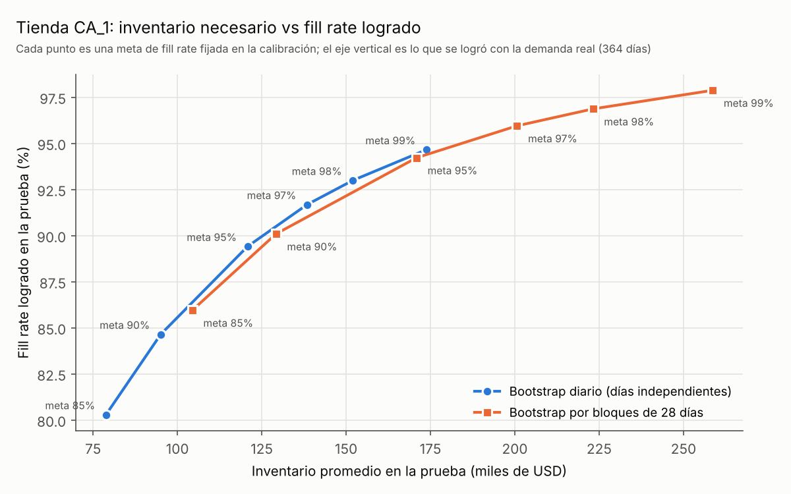
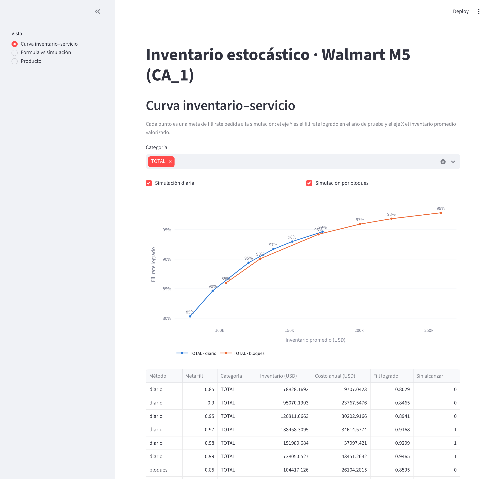

# Inventario estocástico con demanda real (Walmart M5)

[](https://github.com/CastilloFelipe/inventario-estocastico/actions/workflows/tests.yml)

¿La fórmula clásica de stock de seguridad entrega el servicio que promete cuando la demanda
es real? Este proyecto lo prueba con los 3.049 productos de una tienda Walmart (CA_1, datos
M5): calibra una política de revisión periódica (R, S) con la fórmula y con simulación
Monte Carlo, la prueba con un año de demanda que no se usó para calibrar y traduce el
servicio logrado a dólares de inventario. Es un proyecto de portafolio para supply chain y,
a la vez, una forma de aprender modelos estocásticos de inventario.

## Resultados clave (tienda CA_1, 3.039 productos analizados; 10 sin ventas excluidos)

- **La promesa de 95% no se cumple.** Con meta de servicio por ciclo α = 95%, la fórmula
  clásica logra en promedio 0,905 y la simulación con bootstrap diario 0,894.
- **La brecha se asocia a la dependencia entre días más que a la forma normal.** La
  simulación que usa la distribución real (sin suponer normalidad) falla igual que la
  fórmula. La venta de 10 días varía en mediana 1,94 veces lo que supone la independencia,
  y la fórmula logra 0,954 en los productos casi independientes y 0,853 en los más
  dependientes. Parte de esa dependencia puede venir de quiebres en la historia, y los
  cambios de nivel por producto también bajan el servicio; ambos confusores se analizan en
  los resultados.
- **Simular con bloques de 28 días consecutivos cierra cerca de dos tercios de la brecha de la
  fórmula:** α
  0,934 y fill rate ponderado 0,963, a cambio de 32% más inventario que la simulación diaria
  (197.837 vs 150.375 USD).
- **Con bloques, la meta escrita se parece a la lograda.** Pidiendo 95% de fill rate, la
  simulación diaria entrega 89,4% y la de bloques 94,2% (con 120.812 y 170.880 USD de
  inventario, respectivamente).



Detalle, tablas por clase y categoría y limitaciones: [docs/resultados.md](docs/resultados.md).

## Demo

```bash
streamlit run app/streamlit_app.py
```

La app tiene tres vistas: curva inventario-servicio, fórmula vs simulación y una vista por
producto con simulación en vivo. Lee `outputs/` (correr `python main.py`) y, para la vista
de producto, `data/raw/` (correr `python scripts/descargar_m5.py`). Las rutas se pueden
cambiar con `INVENTARIO_OUTPUTS` e `INVENTARIO_RAW`.



## Cómo reproducir

Requiere Python 3.12 o superior.

```bash
pip install -r requirements.txt
python scripts/descargar_m5.py                   # baja los CSV de M5 a data/raw/ (~310 MB)
python main.py --tienda CA_1                     # preguntas A y B -> outputs/ (~12 min)
python scripts/diagnostico_dependencia.py        # dependencia y deriva -> outputs/diagnostico*.csv
python scripts/grafico_curva_b.py                # gráfico -> docs/curva_b.png
pytest -q                                        # tests con datos sintéticos (no requieren M5)
```

La semilla es fija (2026): las mismas entradas producen los mismos resultados.

## Estructura

```
src/inventario/
  datos.py        carga de una tienda M5, división calibración/prueba, precios
  demanda.py      Syntetos-Boylan, ajuste de distribuciones, censura, bootstrap diario y por bloques
  simulador.py    simulación vectorizada de (R, S) con ventas perdidas y lead time aleatorio
  politicas.py    S por fórmula y S por simulación (búsqueda binaria)
  backtest.py     reproduce la demanda real de la prueba con un S dado
  analisis.py     preguntas A y B
app/             app Streamlit (curva, fórmula vs simulación, producto)
main.py           corre el análisis completo y guarda outputs/
scripts/          descarga de datos, diagnóstico de dependencia, gráfico
tests/            pruebas con casos teóricos y datos sintéticos
docs/             conceptos.md, resultados.md, gráfico
```

## Metodología en breve

- **Política (R, S):** cada R = 7 días se pide hasta el nivel S. Lead time aleatorio entre 2 y
  5 días; los quiebres son ventas perdidas.
- **Tres formas de fijar S:** fórmula clásica (z = 1,645), simulación Monte Carlo con
  bootstrap diario por día de semana, y simulación con bootstrap por bloques de 28 días.
- **Calibración y prueba separadas:** se calibra con toda la historia salvo el último año y
  se mide con los últimos 364 días reales.
- **Pregunta A:** α y fill rate logrados por producto, agregados por clase Syntetos-Boylan y
  por categoría. **Pregunta B:** inventario en USD para metas de fill rate de 85% a 99%.

Los conceptos (stock de seguridad, α vs fill rate, bootstrap, autocorrelación, demanda
censurada, etc.) están explicados con un ejemplo en [docs/conceptos.md](docs/conceptos.md).

## Limitaciones

- El lead time es un supuesto (M5 no lo trae).
- Las ventas son demanda censurada: 994 productos tienen rachas de ceros que sugieren
  quiebres en la historia; se marcan, no se corrigen.
- Una sola tienda; no se probó que los resultados se generalicen.
- El largo de bloque (28 días) fue elegido, no ajustado.
- Aun con bloques, α (0,934) queda bajo la meta de 0,95.
- No hay costo de quiebre: se muestra cuánto cuesta cada nivel de servicio, no cuál es el
  óptimo.

## Datos y licencia

Datos: competencia de Kaggle [M5 Forecasting - Accuracy](https://www.kaggle.com/competitions/m5-forecasting-accuracy)
(Walmart, vía la Universidad de Nicosia). Los datos **no se redistribuyen** en este
repositorio: `scripts/descargar_m5.py` los baja (desde un espejo público en GitHub) a
`data/raw/`, que no se versiona. Su uso
está sujeto a las reglas de la competencia.

Código bajo licencia [MIT](LICENSE). Autor: Felipe Castillo, estudiante de Ingeniería Civil
Industrial, Universidad del Desarrollo (Santiago, Chile).
