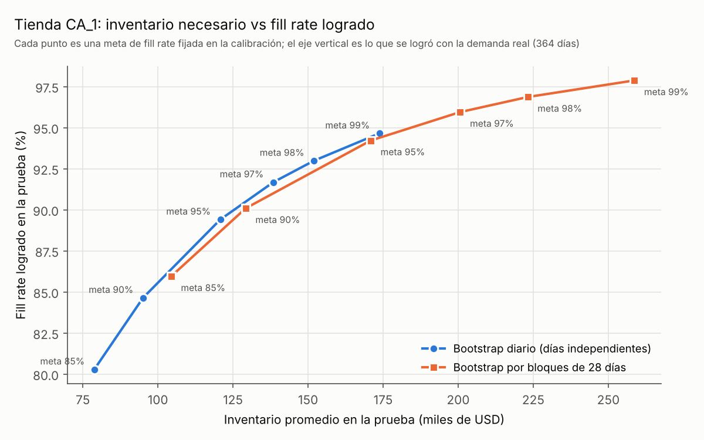

# Resultados: tienda CA_1 (Walmart, datos M5)

Todas las cifras de este documento salen de los archivos que generan `main.py` y
`scripts/diagnostico_dependencia.py` (`outputs/pregunta_a.csv`, `outputs/resumen_a.csv`,
`outputs/curva_b.csv`, `outputs/diagnostico.csv`, `outputs/diagnostico_cruce.csv`). Los
decimales van con coma. Si un concepto no te suena (α, fill rate, bootstrap), está
explicado con un ejemplo en [conceptos.md](conceptos.md).

## La pregunta

Un planificador que usa la fórmula clásica de stock de seguridad con un 95% de servicio
espera que en 95 de cada 100 ciclos de reposición, no le falte producto en góndola.
**¿Se cumple esa promesa con demanda real de retail?** Y si no se cumple, ¿cuánto
inventario cuesta cumplirla?

- **Pregunta A.** Producto por producto, ¿qué servicio logra cada política en un año
  de demanda real que no se usó para calibrarla?
- **Pregunta B.** ¿Cuánto inventario (USD) cuesta cada punto de fill rate en la tienda?

## Datos y montaje

| Elemento | Valor |
|---|---|
| Tienda | CA_1 (California), 3.049 productos en 3 categorías |
| Excluidos | 10 productos sin ninguna venta en la calibración (8 FOODS, 1 HOBBIES, 1 HOUSEHOLD) |
| Analizados | 3.039 productos (todos con precio) |
| Calibración / prueba | Toda la historia salvo el último año / los últimos 364 días |
| Política | Revisión periódica (R, S): cada R = 7 días se pide hasta llegar a S |
| Lead time | Aleatorio, 2, 3, 4 o 5 días con igual probabilidad (**supuesto**: M5 no trae lead times) |
| Quiebre | Ventas perdidas (el cliente que no encuentra el producto no espera) |
| Meta pregunta A | Servicio por ciclo α = 95% |
| Metas pregunta B | Fill rate 85%, 90%, 95%, 97%, 98% y 99% |
| Valorización | Inventario promedio × último precio de calibración; costo de mantener 25% anual |

Se comparan tres maneras de fijar S para cada producto:

1. **Fórmula clásica:** S = μ·(R+L) + 1,645·σ·√(R+L). Supone demanda diaria normal y días
   independientes.
2. **Simulación con bootstrap diario:** se simulan 200 años posibles armando cada día con un
   día real de la historia del mismo día de la semana, elegido al azar. No supone forma
   normal, pero sigue suponiendo días independientes.
3. **Simulación con bootstrap por bloques de 28 días:** igual, pero copiando tramos de 28
   días consecutivos de la historia. Conserva las rachas de días altos o bajos.

Las tres se prueban en el mismo backtest: la demanda real de los 364 días de prueba, con
200 sorteos del lead time.

## Pregunta A: ¿se cumple el 95% prometido?

**No, con ninguno de los dos métodos clásicos.** En promedio por producto, la fórmula logra
α = 0,905 y el bootstrap diario 0,894. El bootstrap por bloques sube a 0,934: cierra la mayor
parte de la brecha, pero tampoco llega a 0,95.

Total de la tienda (3.039 productos):

| Política | α logrado (media por producto) | Productos con α ≥ 0,95 | Fill rate ponderado por demanda | Inventario promedio (USD) | Costo anual de mantener (USD) |
|---|---|---|---|---|---|
| Fórmula clásica | 0,905 | 53,8% | 0,937 | 157.156 | 39.289 |
| Bootstrap diario | 0,894 | 49,0% | 0,933 | 150.375 | 37.594 |
| Bootstrap por bloques | 0,934 | 63,8% | 0,963 | 197.837 | 49.459 |

El bootstrap por bloques necesita un 32% más de inventario que el bootstrap diario
(197.837 vs 150.375 USD) y un 26% más que la fórmula. Ninguna política dejó productos sin
alcanzar la meta en la calibración (`n_no_alcanzado` = 0 en las tres).

### Por clase de demanda (Syntetos-Boylan)

α y fill rate logrados en la prueba; inventario promedio en USD. F = fórmula, D = bootstrap
diario, B = bootstrap por bloques.

| Clase | Productos | α F | α D | α B | Fill F | Fill D | Fill B | USD F | USD D | USD B |
|---|---|---|---|---|---|---|---|---|---|---|
| Errática | 90 | 0,924 | 0,921 | 0,964 | 0,952 | 0,950 | 0,978 | 10.672 | 10.444 | 15.560 |
| Intermitente | 2.196 | 0,905 | 0,892 | 0,931 | 0,924 | 0,917 | 0,953 | 91.976 | 86.856 | 110.274 |
| Irregular (*lumpy*) | 508 | 0,901 | 0,901 | 0,943 | 0,916 | 0,918 | 0,954 | 21.855 | 21.855 | 31.250 |
| Suave | 245 | 0,908 | 0,896 | 0,937 | 0,965 | 0,960 | 0,979 | 32.653 | 31.220 | 40.754 |

### Por categoría

| Categoría | Productos | α F | α D | α B | Fill F | Fill D | Fill B | USD F | USD D | USD B |
|---|---|---|---|---|---|---|---|---|---|---|
| FOODS | 1.429 | 0,897 | 0,890 | 0,938 | 0,942 | 0,939 | 0,969 | 89.416 | 86.882 | 121.126 |
| HOBBIES | 564 | 0,913 | 0,901 | 0,926 | 0,930 | 0,929 | 0,953 | 23.233 | 22.078 | 26.159 |
| HOUSEHOLD | 1.046 | 0,911 | 0,897 | 0,934 | 0,926 | 0,918 | 0,953 | 44.506 | 41.416 | 50.552 |

El fill rate de las tablas es el ponderado por las unidades demandadas en la prueba
(`fill_pond_*`): responde "de cada 100 unidades que pidieron los clientes, cuántas se
vendieron".

## El hallazgo principal: el problema es suponer días independientes

La intuición habitual es que la fórmula falla porque la demanda real no es normal (el 72% de los
productos son intermitentes: venden pocos días y en cantidades chicas). Los
datos dicen otra cosa:

1. **Quitar el supuesto de normalidad no ayuda.** El bootstrap diario usa la distribución
   real de cada producto, sin suponer ninguna forma, y logra lo mismo que la fórmula
   (0,894 vs 0,905). Lo que ambos comparten es suponer que cada día es independiente del
   anterior.
2. **La demanda no se movió de nivel.** La mediana de media diaria en la prueba dividida por
   la media en la calibración es 0,978. A nivel de producto sí hay dispersión (percentil 10:
   0,523; percentil 90: 1,679), pero no hay un desplazamiento general que explique la
   brecha.
3. **Los días no son independientes.** En 2.797 productos con al menos 400 días de historia,
   la varianza de la venta de 10 días es, en mediana, 1,94 veces lo que predice la suma de
   10 días independientes (percentil 25: 1,342; percentil 75: 2,905). El 82,8% de los
   productos supera 1,2. La autocorrelación de un día al siguiente es baja pero
   casi siempre positiva (mediana 0,141; positiva en el 93,3% de los productos). En palabras
   de negocio: los días buenos vienen en rachas, y en una racha la venta de una semana es
   más variable de lo que la fórmula supone.
4. **La brecha crece justo con esa dependencia.** Agrupando los productos según ese
   cociente de varianzas:

| Varianza de 10 días / (10 × varianza diaria) | Productos | α fórmula | α bootstrap diario | α bloques |
|---|---|---|---|---|
| Hasta 1,2 (casi independiente) | 482 | 0,954 | 0,942 | 0,941 |
| 1,2 a 2 | 971 | 0,929 | 0,918 | 0,940 |
| 2 a 3 | 695 | 0,896 | 0,886 | 0,937 |
| Más de 3 | 649 | 0,853 | 0,846 | 0,937 |

Donde los días son casi independientes, la fórmula cumple su promesa (0,954). A medida que
la dependencia crece, la fórmula y el bootstrap diario caen hasta 0,85; el bootstrap por
bloques se mantiene alrededor de 0,94 en todos los tramos.

**Conclusión honesta:** suponer días independientes explica la mayor parte de la brecha.
Copiar bloques de 28 días la cierra en gran parte (de 0,905 a 0,934), a cambio de más
inventario. Aun así queda bajo 0,95, así que hay algo más que este modelo no captura (ver
limitaciones). Esto se observa en una sola tienda; no se probó que se generalice.

## Pregunta B: cuánto inventario cuesta el servicio

Aquí cada método de simulación calibra S para alcanzar una meta de fill rate, y luego se
mide el fill rate efectivamente logrado en la prueba (ponderado por demanda). Total de la
tienda:

| Meta de fill rate | Diario: inventario (USD) | Diario: fill logrado | Diario: sin alcanzar | Bloques: inventario (USD) | Bloques: fill logrado | Bloques: sin alcanzar |
|---|---|---|---|---|---|---|
| 85% | 78.828 | 80,3% | 0 | 104.417 | 86,0% | 0 |
| 90% | 95.070 | 84,6% | 0 | 129.226 | 90,1% | 1 |
| 95% | 120.812 | 89,4% | 0 | 170.880 | 94,2% | 1 |
| 97% | 138.458 | 91,7% | 1 | 200.667 | 95,9% | 5 |
| 98% | 151.990 | 93,0% | 1 | 223.174 | 96,9% | 8 |
| 99% | 173.805 | 94,7% | 1 | 258.654 | 97,9% | 17 |

"Sin alcanzar" cuenta los productos cuya meta no se logró en la calibración ni con el tope
de búsqueda de S.

Tres lecturas:

1. **La promesa del bootstrap diario se queda corta por 4,3 a 5,6 puntos.** Pedir 95%
   entrega 89,4%; pedir 99% entrega 94,7%. Con bloques la diferencia queda dentro de 1,1
   puntos, hacia arriba o hacia abajo (95% entrega 94,2%; 85% entrega 86,0%).
2. **Las dos curvas casi se superponen.** Con un inventario parecido, ambos métodos logran
   un fill rate parecido: el diario con meta 99% usa 173.805 USD y logra 94,7%; bloques con
   meta 95% usa 170.880 USD y logra 94,2%. Es decir, los bloques no hacen más eficiente el
   inventario: hacen que **la meta que uno escribe se parezca a lo que obtiene**. Con el
   método diario, el planificador cree que compró 95% y en realidad compró 89%.
3. **Cada punto extra de servicio cuesta más que el anterior.** En la curva de bloques,
   pasar de 86,0% a 90,1% cuesta 24.809 USD más de inventario (unos 6.000 USD por punto);
   pasar de 96,9% a 97,9% cuesta 35.480 USD más (unos 35.000 USD por punto). Con un costo de mantener de 25% anual, la
   meta de 95% con bloques cuesta 42.720 USD al año y la de 99% cuesta 64.663 USD al año.

Por categoría, con bloques y meta 95%: FOODS logra 95,0% con 103.530 USD, HOBBIES 93,4% con
22.877 USD y HOUSEHOLD 92,5% con 44.473 USD.

## Demanda censurada

994 de los 3.039 productos (32,7%) tienen una racha de días sin venta más larga de lo que
sería razonable si los ceros fueran al azar (columna `censura` de `pregunta_a.csv`). Es
probable que en esos días no hubiera producto en la tienda: la venta registrada no es la
demanda real. Su servicio logrado no es peor que el del resto (α con bloques 0,945 vs 0,929
en los no marcados), pero eso no prueba nada sobre su demanda verdadera: si los quiebres
de la historia escondieron demanda, todas las políticas la subestiman por igual. La marca
es mucho más común en productos suaves y erráticos (77,6% y 94,4%) que en intermitentes
(22,5%), porque en un producto que vende casi todos los días una racha larga de ceros es
muy improbable.

## Limitaciones

- **Lead time supuesto.** M5 no informa lead times; se asumió uniforme entre 2 y 5 días. Con
  lead times reales más largos o más variables, todas las políticas necesitarían más
  inventario.
- **Demanda censurada.** Las ventas son una cota inferior de la demanda en días de quiebre.
  No se corrigieron los datos; se marcaron y se reportan.
- **Una sola tienda.** Los resultados son de CA_1. El código permite correr otra
  (`--tienda`), pero no se hizo aquí.
- **Largo de bloque elegido, no ajustado.** 28 días (cuatro semanas) es una elección
  razonable que conserva el patrón semanal; no se probó si otro largo funciona mejor.
- **Con bloques, α sigue bajo 0,95** (0,934). La política más cercana a la promesa sigue sin
  cumplirla, y lo hace con 32% más inventario que el bootstrap diario.
- **α por producto es ruidoso.** Un año de prueba tiene 52 ciclos de revisión; con tan pocos
  ciclos, un producto que en verdad cumple 95% puede medir 90% por azar. Por eso las
  conclusiones se apoyan en promedios de cientos o miles de productos, no en casos
  individuales.
- **Sin costo de quiebre.** El análisis muestra cuánto cuesta cada nivel de servicio, no cuál
  es el nivel óptimo; para eso hace falta el margen perdido por unidad no vendida.
- **El origen de la dependencia no está identificado.** Promociones, clima, eventos o los
  propios quiebres (rachas de ceros) pueden generarla; este análisis la mide, no la explica.
